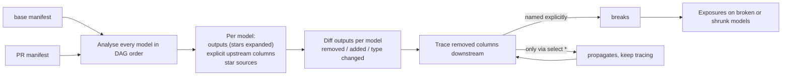

# dbt-impact

[](https://github.com/amritanshagrawal99/dbt-impact/actions/workflows/ci.yml)
[](LICENSE)

**Column-level impact analysis for dbt pull requests.** Compare the base branch's `manifest.json` with the PR's, and get a PR
comment listing exactly which downstream models and exposures (dashboards, apps) the change breaks.

`dbt build --select state:modified+` tells you *which models* to rebuild. It doesn't tell you that renaming `first_name` in a
staging model will break a mart three levels down, or that dropping a column silently removes it from every
`select *` model in between. dbt-impact reads the compiled SQL of every model with [sqlglot](https://github.com/tobymao/sqlglot),
works out which upstream columns each model actually uses, and traces removed columns through the DAG.

No warehouse connection is needed for the analysis. It runs on the two manifests.

## What the PR comment looks like

The example project in [`examples/shop`](examples/shop) runs this PR:
- `stg_customers`: `first_name` renamed to `given_name`, `email` dropped
- `stg_orders`: `status` dropped

> ## dbt impact analysis
> **3 breaking reference(s)** and **2 exposure(s) at risk**.
>
> ### Breaking
> | Downstream model | Reads removed column | Caused by | Fix |
> |---|---|---|---|
> | `customers` | `stg_customers.first_name` | `stg_customers` | replace `first_name` with `given_name` |
> | `customer_contacts` | `stg_customers.email` | `stg_customers` | - |
> | `customers` | `orders.status` | `stg_orders` | - |
>
> ### Exposures at risk
> | Exposure | Type | Owner | Depends on | Why | Columns |
> |---|---|---|---|---|---|
> | `crm_sync` | application | CRM team | `customer_contacts` | upstream model breaks | `email` |
> | `revenue_dashboard` | dashboard | Analytics | `customers`, `orders` | upstream model breaks | `first_name`, `status` |
>
> ### Propagated through `select *`
> - `orders` loses `status` (from `stg_orders`)
>
> Looks like `stg_customers.first_name` was renamed to `given_name`. Downstream models still using `first_name` will fail.

The third row is the interesting one. `customers` never reads `stg_orders`. It reads `orders.status`, and `orders` gets `status`
only through `select o.*`. dbt-impact follows the column through the star and credits the break to the real origin.
Full report: [docs/example-report.md](docs/example-report.md).

## Usage

```bash
pip install "git+https://github.com/amritanshagrawal99/dbt-impact.git"

dbt-impact --base base/target/manifest.json --current target/manifest.json            # Markdown to stdout
dbt-impact --base ... --current ... --format json -o impact.json                      # for pipelines
dbt-impact --base ... --current ... --fail-on-breaking                                # exit 1 in CI
dbt-impact --base ... --current ... --base-catalog base/catalog.json --current-catalog target/catalog.json  # + type changes
```

Both manifests must come from `dbt compile` (or `build`/`run`), so that `compiled_code` is present. Many teams already keep
the production manifest as a CI artifact for `state:modified`, and that works as `--base`.

### GitHub Action

```yaml
- uses: amritanshagrawal99/dbt-impact@main
  with:
    base-manifest: base/target/manifest.json
    current-manifest: pr/target/manifest.json
    fail-on-breaking: "true"   # default
```

The action posts a single PR comment and updates it on each push. It also writes the report to the job summary and sets an
output called `has-breaking`. A complete workflow is in [docs/example-workflow.yml](docs/example-workflow.yml).

## How it works



- **Schemas are inferred, not fetched.** Models are analysed in topological order, and each model's output columns become the
  schema for its children. Seeds and sources use the columns documented in YAML, or `catalog.json` if you pass one.
- **Two qualification passes.** sqlglot's `qualify` runs once with stars expanded, which gives each model's real output columns,
  and once without, which gives the columns it *names* versus the ones it only passes through `*` / `alias.*`. The difference
  decides between "breaks" and "propagates".
- **Columns are resolved through CTEs.** A column read from a CTE is traced to the table behind it, including through
  `select *` CTEs.
- **Breaking SQL still gets analysed.** A model that reads a column which no longer exists can't be qualified against the new
  schema. dbt-impact then re-qualifies it without a schema, so the broken reference is still found.

### Model contracts

For models with `contract: {enforced: true}`, the declared columns are a public API, so changes to them are reported in their
own **Contract violations** section and count as breaking:

| Problem | Example |
|---|---|
| Column removed from the contract | `email` was declared on the base branch and isn't any more |
| Declared type changed | `customer_id: integer -> bigint` |
| Contract out of sync with the SQL | a column is declared but not produced (or produced but not declared), which `dbt build` will reject |

### Behaviour changes without column changes

Some settings change what the data means while every column stays the same. These are listed in their own section. They
don't fail the check, but a reviewer should see them:

| Node | Settings |
|---|---|
| Snapshots | `strategy`, `unique_key`, `updated_at`, `check_cols`, hard-delete handling |
| Sources | freshness `warn_after` / `error_after`, `loaded_at_field` |

## Limitations

- Jinja-heavy models are analysed through their compiled SQL, so behaviour that depends on `target` / `var()` values reflects the
  compile you ran.
- `PIVOT` and dialect features that sqlglot can't parse are reported under "could not be analysed" rather than guessed.
  Stars are traced through CTEs, derived tables and every branch of `UNION` / `INTERSECT` / `EXCEPT`.
- Type changes require a `catalog.json` (from `dbt docs generate`) or documented `data_type`s.

## Development

```bash
python -m venv .venv && . .venv/bin/activate
pip install -e ".[dev]" dbt-duckdb
python examples/build_manifests.py   # regenerate fixtures from the example project with real dbt
pytest && ruff check src tests
```

## License

[MIT](LICENSE). Built on [sqlglot](https://github.com/tobymao/sqlglot) (MIT).
